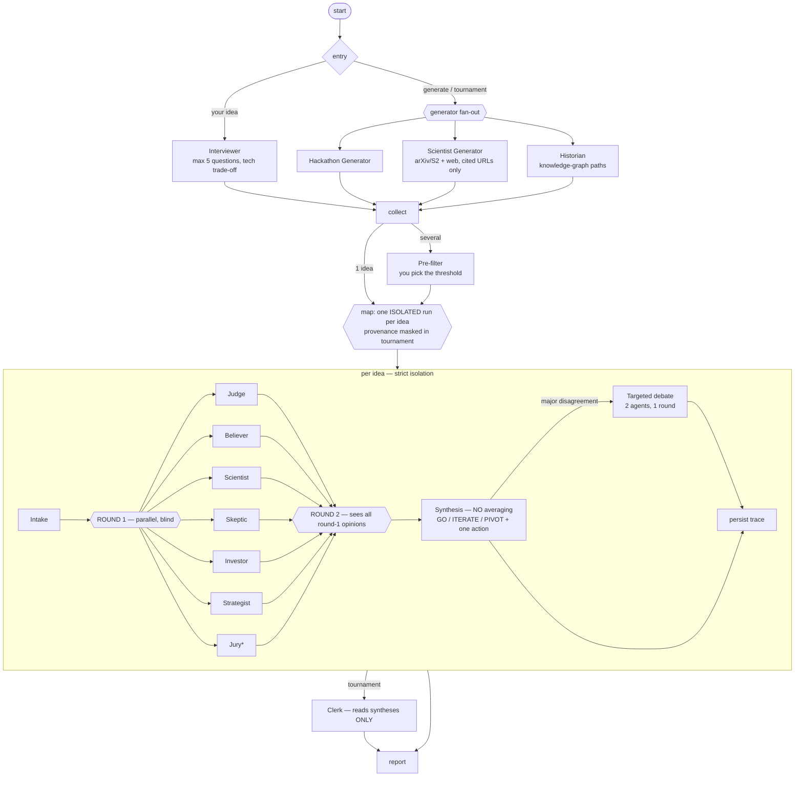

# condorium

> **Your AI thinks every idea is genius — or kills it with "it already exists". This committee does neither.**

[](https://github.com/Wassbdr/condorium/actions)
[](LICENSE)
[](pyproject.toml)

`condorium` is a two-layer multi-agent system for evaluating ideas — yours, or ideas it generates itself:

1. **The Cohort** (upstream) — idea generators: an Interviewer that refines *your* idea, a Hackathon Generator, a Scientist that mines real papers, and a Historian that navigates a knowledge graph of past hackathon winners.
2. **The Committee** (downstream) — a panel that evaluates each idea in two rounds: blind first, deliberation second. No flattery, no lazy rejection.

The anti-sycophancy claim is not vibes — it is **measured** (`panel bench --sycophancy`, see [below](#prove-it-the-anti-sycophancy-bench)). The guardrails are structural, enforced in code:

| the usual failure | the structural fix |
|---|---|
| "This is genius!" for everything | the **Believer**'s score is *hard-capped in code* at the panel median + 3, and he must cite a real precedent or admit he can't |
| "It already exists" as a verdict | forbidden for the **Skeptic** — competition is a data point; every doubt must ship with a concrete 30-minute test or it is *deleted in code* |
| Hallucinated "studies show…" | the **Scientist** may only cite papers retrieved by the arXiv/Semantic Scholar APIs *during* the run — off-list references are stripped by the orchestrator, and a `debunked` verdict must come with contradicting sources |
| "No papers about it" as a penalty | a `neutral` scientific verdict sets `score: null` — excluded from every median and ranking, informational only |
| Averaged scores that hide the real question | averaging is **forbidden** in the synthesis; disagreements are surfaced, and a major one triggers a targeted debate: exactly 2 agents, exactly 1 round |

## Try it in 30 seconds — no API key

```bash
uvx --from git+https://github.com/Wassbdr/condorium panel demo
# or: pip install git+https://github.com/Wassbdr/condorium && panel demo
```

`panel demo` replays recorded evaluations with the full display — including a "revolutionary" idea getting a calm **PIVOT**, and a scientist honestly declaring "neutral, no penalty".

## Real usage

```bash
export ANTHROPIC_API_KEY=...        # or any LiteLLM provider:
# export CONDORIUM_MODEL=openai/gpt-4o        (OPENAI_API_KEY)
# export CONDORIUM_MODEL=mistral/mistral-large-latest
# export CONDORIUM_MODEL=ollama/llama3        (fully local)

# evaluate YOUR idea (the Interviewer refines it first — 5 questions max)
panel eval "an app that ..." --mode hackathon --constraints "24h, team of 3"

# generate ideas from one source, pre-filter, evaluate the survivors
panel generate --source scientist --theme "health" --duration 24h

# full tournament: several generators, provenance masked from the committee
panel tournament --sources hackathon,scientist,historian --context ctx.md --top 3

panel show <id>        # replay an evaluation      panel history
panel report <id>      # self-contained HTML       panel dashboard
panel pitch <id>       # pitch pack from the stored JSON — zero new LLM calls
panel record <id> --result "2nd place"             # feed the track record
panel coach            # data-driven prompt diffs — YOU approve each one
```

French prompt variants: add `--lang fr`.

## The pipeline (LangGraph)

`Cohort → [Pre-filter] → Intake → Committee (2 rounds) → Synthesis → [Clerk if tournament]` — one `StateGraph`, native fan-out/fan-in, `interrupt()` for every human decision, SQLite checkpointing (an interrupted tournament resumes without re-paying completed calls). Print the live version: `panel graph`.



\* Jury sits in hackathon mode only: a tired judge who has seen 20 pitches and remembers moments, not feature lists.

## The committee

| agent | evaluates | its leash |
|---|---|---|
| **Judge** | feasibility, execution | anchored rubrics (3 = unrealistic without exceptional resources, 8 = small team ships in months); in hackathon mode scores the *official* grid AND the *implicit* one (wow, polish, storytelling) separately; **may never fully reject** — must output a viable reduced scope |
| **Believer** | potential, differentiation | capped at median+3, real precedent required, zero love for generic templates |
| **Scientist** | scientific grounding | verdicts `grounded` / `neutral` (no penalty, `score: null`) / `debunked` (with sources); API-retrieved references only |
| **Skeptic** | assumptions, blind spots | every doubt ships with a test or is deleted; "it already exists" never suffices |
| **Investor** | market, monetization, timing | anchor: 8 = would take a second meeting; hackathon mode judges *the after* |
| **Strategist** | the angle of attack | always proposes the best *alternative* angle |
| **Jury** (hackathon) | memorability after 20 pitches | writes down the one sentence it would actually retain |

**Add your own agent with zero Python**: drop a markdown file in [agents/community/](agents/community/SCHEMA.md). Anchored rubrics required.

## Prove it: the anti-sycophancy bench

```bash
panel bench --sycophancy --n 20
```

Each sampled idea is rewritten in 3 tone variants with identical content — *enthusiastic* ("my revolutionary idea!"), *neutral*, *deprecating* ("probably already taken, nothing special") — and each variant goes through the full committee, in isolation, in randomized order. **Formulation bias** = mean score spread between variants, global and per agent. Target: 0. An agent with a high bias has a prompt to harden — and `panel coach` will propose the hardening, backed by the failing cases.

The winner-prediction bench uses real hackathon data:

```bash
panel bootstrap --dataset devpost.json     # e.g. a Devpost dump (Kaggle/HF)
panel bench --dataset devpost.json --n 50 --seed 42
```

It builds (winner, non-winner) pairs from the same hackathon, **strips every victory clue** (badges, "winner", prize amounts — the anti-leak pass is unit-tested), evaluates both blind, and reports: winner-identification rate, per-agent precision (learn *which agent to listen to*), and score calibration. Results are seed-reproducible.

## The learning loop

```
bench errors + track record + formulation bias
        │
        ▼
  panel coach  ──proposes──▶  unified diffs on agents/*.md
        │                        (≥ 3 concordant cases each, never fewer)
        ▼
  YOU approve/refuse each diff  ──▶  agents/CHANGELOG.md (auditable)
```

The Coach never edits a prompt itself. Every accepted diff is journaled with the metric that motivated it.

## Knowledge graph

Winners ingested via `panel ingest <url>` or `panel bootstrap --dataset <path>` feed a typed NetworkX graph (`Project`, `Tech`, `Theme`, `Pattern`, `Paper` / `WON`, `USES`, `ABOUT`, `EXPLOITS_PATTERN`, `INSPIRED_BY`) serialized to a plain JSON file — no database. It powers:

- the **Historian**, which hunts unexploited combinations ("this tech won in 3 themes but never in yours") and abstains honestly when the base is empty;
- **calibration**: the 5 nearest past winners are injected into the Judge's and Jury's prompts in hackathon mode;
- the knowledge-graph view in HTML reports.

A weekly refresh is one external cron line: `python scripts/ingest_winners.py <url>`.

## Examples

[examples/](examples/) contains famous ideas at their initial stage — including [Airbnb as pitched in 2008](examples/airbnb-2008.md), the canonical "rejected by everyone, killed with *Craigslist exists*" idea. Run them through your own committee and check whether it does better than 2008's investors.

## Project layout

```
agents/          every prompt, one .md per agent per mode (+ community/, + fr/)
src/condorium/   the package: graph/ (LangGraph), knowledge/, analytics/, bench/
knowledge/       winners.json, summaries/, graph.json
evaluations/     full traces of every run (JSON) + reports
scripts/         ingest_winners.py, bootstrap_from_dataset.py
```

## Roadmap

- **Phase 2 — simulated population** (`panel population <id>`, stub shipped): 6 realistic personas (≥ 2 natural skeptics) react to a verdict in their own voice with an adoption call and a global insight.

## Contributing

See [CONTRIBUTING.md](CONTRIBUTING.md) — community agents are the easiest entry point (a single markdown file), good first issues are labeled. Tests run without any API key: `pytest`.

MIT © Wassim Badraoui
