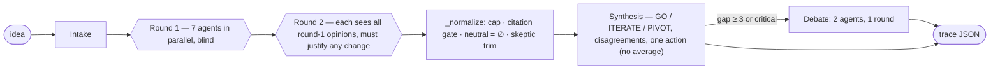

# condorium

**A committee of seven LLM agents that evaluates an idea in two rounds (blind, then deliberation) and is built, in code, not to flatter you: for builders, hackathon teams and anyone who wants LLM feedback they can trust.**


```bash
git clone https://github.com/Wassbdr/condorium && cd condorium
uv venv -p 3.11 && uv pip install -e .
.venv/bin/panel demo        # offline replay of two recorded runs, no API key
```

Or with Docker: `docker build -t condorium . && docker run --rm -it condorium` (add `panel ui` and `-p 7860:7860` for the web UI).

## Key result: committee vs single judge, same token budget

Measured live in this repo; small sample, see [limitations](#roadmap-and-known-limitations).

<!-- versus:start -->
**Winner picked: committee 67%, single judge at the same token budget 100%, single judge in one call 100%.** The committee costs 41x the tokens of one judge call.

| system | winner picked | ± sd over 1 seed(s) | tone flip rate | tokens / idea | calls / idea |
|---|---|---|---|---|---|
| Committee (7 agents, 2 rounds) | 67% | 0% | 0% | 95,847 | 19.0 |
| Single judge, same token budget | 100% | 0% | 0% | 103,900 | 45.2 |
| Single judge, 1 call | 100% | 0% | 100% | 2,324 | 1.0 |

Setup: 3 synthetic winner/non-winner pairs (fixtures/bench), seeds [0], nvidia/nemotron-3.5-lightning-30b-a3b via NVIDIA NIM, 8-CPU VM, no GPU. Tone cases (same idea rewritten enthusiastically): 1. Agreement committee vs same-budget judge: 67% of pair picks, 83% of verdicts. 448 LLM calls in the measured systems. Believer cap fired 0 times, debates 6. Raw data: [`showcase/results/versus_results.json`](showcase/results/versus_results.json), regenerate with `LIVE=1 bash showcase/make_showcase.sh`.
<!-- versus:end -->

## One verdict, explained

<!-- verdict:start -->
From the recorded run [`01-transit-copilot.json`](fixtures/demo/01-transit-copilot.json) (`panel demo fixtures/demo/01-transit-copilot.json`): *Transit Copilot* — A phone app that watches the city's live bus/tram feeds and proactively reroutes commuters BEFORE a delay is officially announced, by detecting anomalies in veh…

1. **Round 1, blind**: judge 7, believer 8, scientist_eval 6, skeptic 5, investor 6, strategist 7, jury 7.
2. **Cap**: the believer may not exceed median(others' blind scores) + 3 = **9.5**; it asked for 7 (blind: 8), within the cap.
3. **Round 2, after reading everyone**: believer 8→7, skeptic 5→6; every change comes with a stated reason.
4. **Verdict GO**: Feasible in 24h on public data with a demo that explains itself; every agent conditions the upside on one unmeasured number — the lead time over official alerts.
5. **No average**: the synthesis reports the disagreement instead — *size of the lead-time advantage* (believer: the wedge is Citymapper-grade if it holds; skeptic: it may be 90 seconds of nothing), because the entire differentiation is this number.
6. **One next action**: Tonight, before any app code: log 24h of feed vs official alerts and compute the median lead time.
<!-- verdict:end -->

## Anti-sycophancy rules enforced in code (not in prompts)

All in [`evaluation.py::_normalize`](src/condorium/graph/evaluation.py) and the synthesis/debate nodes, guarded by `tests/test_committee_rules.py`:

| the usual failure | the rule the orchestrator enforces |
|---|---|
| "This is genius!" for everything | the **Believer**'s round-2 score is **capped at the median of the others' blind scores + 3** |
| Hallucinated "studies show…" | the **Scientist** may cite only papers/pages **retrieved during the run** (arXiv, Semantic Scholar, web); any other reference is stripped |
| "No papers about it" as a penalty | a `neutral` scientific verdict sets **`score: null`**, excluded from every median and ranking |
| "It already exists" as a verdict | every **Skeptic** doubt must ship with a concrete test; doubts beyond the number of tests are deleted |
| Averaged scores that hide the real question | the synthesis **never averages**: it lists disagreements; a major one (gap ≥ 3 or critical) triggers a debate of **exactly 2 agents, 1 round** |
| Winner leaks in benchmark data | victory clues (prizes, badges, "winner"…) are **stripped before the committee sees an entry**; a paraphrased clue is a documented limit (strict `xfail` test) |

## How it works



More: the full [LangGraph pipeline](#the-pipeline-langgraph) (cohort generators, pre-filter, tournament, SQLite checkpointing), the [committee](#the-committee), the [benchmarks](#benchmarks).

## Web UI

```bash
uv pip install -e ".[ui]" && .venv/bin/panel ui     # http://localhost:7860
```

**Replay (no key)** plays a recorded run agent by agent. **Live** streams a real evaluation. **Compare** evaluates two proposals against a rubric you can edit in the browser.

## Real usage

For `panel compare`, see the [tutorial](docs/tutorial.md) for custom rubrics, batch input, and offline replay.

```bash
export ANTHROPIC_API_KEY=...        # or any LiteLLM provider:
# export CONDORIUM_MODEL=openai/gpt-4o        (OPENAI_API_KEY)
# export CONDORIUM_MODEL=mistral/mistral-large-latest
# export CONDORIUM_MODEL=ollama/llama3        (fully local)

# evaluate YOUR idea (the Interviewer refines it first — 5 questions max)
panel eval "an app that ..." --mode hackathon --constraints "24h, team of 3"

# generate ideas from one source, pre-filter, evaluate the survivors
panel generate --source scientist --theme "health" --duration 24h

# full tournament: several generators, provenance masked from the committee
panel tournament --sources hackathon,scientist,historian --context ctx.md --top 3

panel show <id>        # replay an evaluation      panel history
panel report <id>      # self-contained HTML       panel dashboard
panel pitch <id>       # pitch pack from the stored JSON — zero new LLM calls
panel record <id> --result "2nd place"             # feed the track record
panel coach            # data-driven prompt diffs — YOU approve each one
```

French prompt variants: add `--lang fr`.

## The pipeline (LangGraph)

`Cohort → [Pre-filter] → Intake → Committee (2 rounds) → Synthesis → [Clerk if tournament]` — one `StateGraph`, native fan-out/fan-in, `interrupt()` for every human decision, SQLite checkpointing (an interrupted tournament resumes without re-paying completed calls). Print the live version: `panel graph`.


\* Jury sits in hackathon mode only: a tired judge who has seen 20 pitches and remembers moments, not feature lists.

## The committee

| agent | evaluates | its leash |
|---|---|---|
| **Judge** | feasibility, execution | anchored rubrics (3 = unrealistic without exceptional resources, 8 = small team ships in months); in hackathon mode scores the *official* grid AND the *implicit* one (wow, polish, storytelling) separately; **may never fully reject** — must output a viable reduced scope |
| **Believer** | potential, differentiation | capped at median+3, real precedent required, zero love for generic templates |
| **Scientist** | scientific grounding | verdicts `grounded` / `neutral` (no penalty, `score: null`) / `debunked` (with sources); API-retrieved references only |
| **Skeptic** | assumptions, blind spots | every doubt ships with a test or is deleted; "it already exists" never suffices |
| **Investor** | market, monetization, timing | anchor: 8 = would take a second meeting; hackathon mode judges *the after* |
| **Strategist** | the angle of attack | always proposes the best *alternative* angle |
| **Jury** (hackathon) | memorability after 20 pitches | writes down the one sentence it would actually retain |

**Add your own agent with zero Python**: drop a markdown file in [agents/community/](agents/community/SCHEMA.md). Anchored rubrics required.

## Benchmarks

**Committee vs single judge** (`src/condorium/bench/versus.py`):

```bash
export NVIDIA_NIM_API_KEY=...   # free tier; any LiteLLM provider works
CONDORIUM_MODEL=nvidia_nim/nvidia/nemotron-3.5-lightning-30b-a3b CONDORIUM_RPM=36 \
  panel bench --versus --n 3 --tone 1 --seeds 0,1,2 --out showcase/results/versus_results.json
```

- **Pairs**: [`fixtures/bench/synthetic_pairs.json`](fixtures/bench/README.md), 18 fictitious hackathons, one winner and one non-winner each (12 easy, 6 hard), generated for this repo, no real project or person. Victory clues are stripped before any system sees an entry.
- **Systems**: the full committee (intake, 7 agents × 2 rounds, synthesis, optional debate) vs one judge ([`agents/system/single_judge.md`](agents/system/single_judge.md)) **re-sampled until it has spent the same number of tokens as the committee on that entry**, aggregated by majority verdict and median score. The judge's first sample alone is the 1-call baseline.
- **Metrics**: winner picked (verdict rank, then median score; tie = ½), tokens and calls per idea (provider-reported usage), agreement between systems, and **tone sensitivity**: the same idea rewritten enthusiastically, how often the verdict flips.
- **Seeds** 0, 1, 2 select the pairs and are forwarded to the provider. `CONDORIUM_MAX_CALLS` is a hard call budget, `CONDORIUM_CALL_LOG` an audit ledger.
- Fully tested offline against a deterministic fake LLM (`tests/test_bench_versus.py`).

**Formulation bias** (`panel bench --sycophancy --n 20`): each idea in 3 tone variants with identical content (enthusiastic, neutral, deprecating); bias = mean score spread, global and per agent.

**Winner prediction on your own data** (`panel bootstrap --dataset devpost.json && panel bench --dataset devpost.json --n 50 --seed 42`): same-hackathon pairs, anti-leak pass, per-agent precision.

## The learning loop

```
bench errors + track record + formulation bias
        │
        ▼
  panel coach  ──proposes──▶  unified diffs on agents/*.md
        │                        (≥ 3 concordant cases each, never fewer)
        ▼
  YOU approve/refuse each diff  ──▶  agents/CHANGELOG.md (auditable)
```

The Coach never edits a prompt itself. Every accepted diff is journaled with the metric that motivated it.

## Knowledge graph

Winners ingested via `panel ingest <url>` or `panel bootstrap --dataset <path>` feed a typed NetworkX graph (`Project`, `Tech`, `Theme`, `Pattern`, `Paper` / `WON`, `USES`, `ABOUT`, `EXPLOITS_PATTERN`, `INSPIRED_BY`) serialized to a plain JSON file — no database. It powers:

- the **Historian**, which hunts unexploited combinations ("this tech won in 3 themes but never in yours") and abstains honestly when the base is empty;
- **calibration**: the 5 nearest past winners are injected into the Judge's and Jury's prompts in hackathon mode;
- the knowledge-graph view in HTML reports.

A weekly refresh is one external cron line: `python scripts/ingest_winners.py <url>`.

## Examples

[examples/](examples/) contains famous ideas at their initial stage — including [Airbnb as pitched in 2008](examples/airbnb-2008.md), the canonical "rejected by everyone, killed with *Craigslist exists*" idea. Run them through your own committee and check whether it does better than 2008's investors.

## Project layout

```
agents/          every prompt, one .md per agent per mode (+ community/, + fr/)
src/condorium/   the package: graph/ (LangGraph), knowledge/, analytics/, bench/
knowledge/       winners.json, summaries/, graph.json
evaluations/     full traces of every run (JSON) + reports
scripts/         ingest_winners.py, bootstrap_from_dataset.py
```

## Roadmap and known limitations

- **Anti-leak cleaning is lexical.** Explicit clues ("won the Grand Prize ($5,000)") are removed and tested; a paraphrase ("took home the top honour of the night") survives. `tests/test_bench_antileak.py::test_paraphrased_winning_clue_is_removed` is a strict `xfail` that documents it. Next: an LLM or NLI-based leak detector as a second pass.
- **The live comparison is small and partial.** Only seed 0 (3 pairs, 6 ideas, 1 tone case) completed on the NVIDIA NIM free tier; seeds 1 and 2 were stopped by sustained HTTP 429 throttling. One pair moves accuracy by 33 points: read the table as a measured sanity check, not a verdict. Finish it with the same command plus `--resume` (finished seeds and entries are cached, never re-paid). Next: more pairs, all 3 seeds, a second model.
- **Debate fires on every idea with this model** (6/6): the gap ≥ 3 trigger may be too loose for a 30B model's score spread.
- **Synthetic pairs.** Winners and non-winners were written for this repo with deliberate quality gaps; real Devpost data (`panel bootstrap`) is supported but not redistributed.
- **The demo is a replay** of recorded runs (said on screen and in `showcase/showcase.json`). `panel ui` → Live, or `panel eval`, computes live.
- **Phase 2: simulated population** (`panel population <id>`, stub shipped): 6 personas react to a verdict with an adoption call.

## Contributing

See [CONTRIBUTING.md](CONTRIBUTING.md) — community agents are the easiest entry point (a single markdown file), good first issues are labeled. Tests run without any API key: `pytest`.

MIT © Wassim Badraoui
